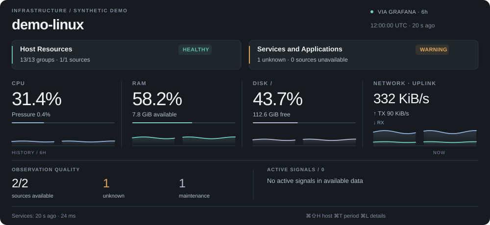
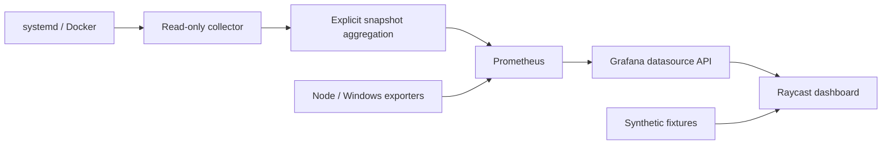

# Infrastructure Observatory

A Raycast dashboard for understanding host resources, discovered services and the quality of the underlying observations. It brings collection, aggregation and visualization together so that missing or stale data stays visible.

**My role:** I designed and implemented the collection and integration layer and the Raycast experience. [Explore the synthetic demo](https://timsmykov.github.io/infrastructure-observatory/) · [Read the case study](docs/case-study.md).



Prometheus, Grafana, Raycast and the operating-system exporters are existing upstream tools, credited in [NOTICE](NOTICE.md).

The project grew out of operating a small mixed infrastructure: a resource number is useful only if you can tell whether its source is fresh and its coverage is complete. The dashboard keeps resource state, service state and missing observations visible together.

[Open the synthetic browser demo](https://timsmykov.github.io/infrastructure-observatory/)

## Try the synthetic demo

Requires Node.js 22 or newer, pnpm and Python 3.10 or newer. This path needs no accounts, tokens, servers or Raycast installation.

```sh
cd raycast
pnpm install --frozen-lockfile
pnpm run demo
cd ..
python3 -m http.server 8080 --bind 127.0.0.1
```

Open [the local demo](http://127.0.0.1:8080/demo/). It uses the extension's actual SVG renderer and detail view model with synthetic Linux/Windows data, a stale host and gaps in history. It is a browser preview of the rendering; the native command runs in Raycast on macOS.

To import the native extension on a Mac with Raycast installed, run `pnpm run dev` inside `raycast/`. The default connection is **Demo** and makes no network requests.

## What is included

- An English Raycast command with a graphical overview, metric/service details, host selection and 1/6/24-hour history.
- A read-only Linux systemd/Docker collector and an explicit file-based multi-host snapshot aggregator.
- Existing Prometheus/Grafana query integrations for Linux and Windows, with coverage-aware state calculation.
- Separate healthy, warning, critical, maintenance and unknown states. Stale or missing data is not converted into zero or success.
- SSH and HTTPS client implementations, local caching and source-freshness checks. Connection-specific setup and limitations are documented in [the integration guide](docs/integration.md).

## Architecture



The public edition does not install services or recreate the original private monitoring deployment. The exported collector is Linux-specific; Windows resource queries expect an existing Windows exporter and the documented profile contract. The custom resource-profile metrics must be supplied for a complete live overview. Ordinary node metrics alone will intentionally leave coverage **unknown**.

## Verify

```sh
cd raycast
pnpm test
pnpm run typecheck
pnpm run lint
pnpm run build
cd ../collector
python3 -m unittest -v
```

See [the case study](docs/case-study.md), [integration contract](docs/integration.md), [verification and limitations](docs/verification.md), and [provenance](NOTICE.md).

## Status

Public portfolio edition. The deterministic demo and exported components are intended for inspection and local evaluation. A public Store listing and a generic turnkey monitoring deployment are outside this release. Component liveness does not establish application readiness or successful user journeys. Last verification details are recorded with this release.
